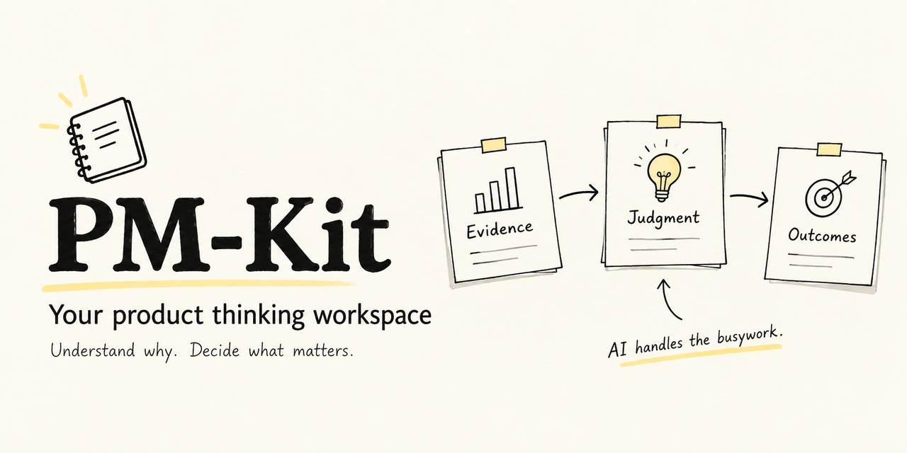

# PM-Kit

Turn your AI coding tool into a PM workspace, knowledge hub, and execution engine.

## Disclaimer

This is not gospel. This is not the holy grail.

PM-Kit is one system that works. It is a guideline and mindset shift, not a rigid rulebook.

The principles in `_core/MANIFESTO.md` may resonate with you, or they may not. That is fine.
Take what works. Ignore what does not. Make it yours.

You will get better results through repetition. The framework should adapt to your workflow, not the other way around.

## Quick Start

### Option A: CLI Install (Recommended)

```bash
# 1. Install the CLI
curl -fsSL https://raw.githubusercontent.com/kv0906/pm-kit/main/cli/install.sh | bash

# 2. Create your vault
pm-kit init ~/Documents/my-vault
cd ~/Documents/my-vault

# 3. Open the folder in Obsidian, then run Claude Code
claude
/onboard
```

### Option B: GitHub Template

```bash
# 1. Use this template on GitHub (or clone)
git clone <your-repo-url>
cd pm-kit

# 2. Open the folder in Obsidian

# 3. Run Claude Code
claude
/onboard
```

`/onboard` sets up your project, learns your preferences, and loads context. Full walkthrough: **[START_HERE.md](START_HERE.md)**

### Amp Orbs

Fresh Amp orbs run `.agents/setup` to prepare shell tools and locked document-export
dependencies (Python, Node, LibreOffice, Pandoc, PDF tools, and OCR). Amp can reuse
the prepared snapshot; warm setup checks existing packages instead of reinstalling them.
`.agents` is a symlink to `.claude`, where the lifecycle scripts are tracked.

The setup does not run the interactive vault wizard, edit your notes or configuration,
or authenticate integrations. QMD and account-specific integrations remain optional.
There are no persistent services to start; `.agents/resume` performs no installs.
New login shells inside the repository automatically use the document-tools Python
environment and Node module path.

To verify setup manually from the repository root:

```bash
./.agents/setup
./.agents/resume
bash -lc 'python -c "import openpyxl, reportlab"; node -e "require(\"docx\"); require(\"pptxgenjs\")"'
```

Dependency manifests and locks live in `.claude/orb/`. To update them, edit
`requirements.in` or `package.json`, regenerate the corresponding lock, and commit it:

```bash
uv pip compile .claude/orb/requirements.in -o .claude/orb/requirements.txt --python-version 3.11
npm install --prefix .claude/orb --package-lock-only --ignore-scripts
```

Orb setup must reach the project's default branch before future orbs use it.

## Daily Routine

```
/today                # Guided workflow: standup → sync → review → focus → wrap-up
/today wrap           # Jump to end-of-day summary
```

Or for quick atomic updates:

```
/daily my-project: shipped X, wip Y, blocked on Z
/push
```

## Weekly Routine

```
/weekly
/push
```

## Updating

```bash
# CLI users
pm-kit update            # Update framework files from latest release
pm-kit self-update       # Update the CLI itself

# Template users
./scripts/update.sh      # Update framework files from latest release
```

Or from within Claude: `/update`

Updates only touch framework files (skills, templates, scripts, docs). Your notes, config, and content are never modified. Backups are saved to `_archive/_updates/`.

## All Commands

| Command | Purpose |
|---------|---------|
| `/today` | Guided daily workflow orchestrator |
| `/daily` | Multi-project standup logging |
| `/progress` | Cross-project status synthesis |
| `/preview` | Render docs and reports as styled HTML |
| `/report` | Executive brief in plain language (CEO/PO view) |
| `/block` | Structured blocker capture |
| `/decide` | Decision records with alternatives |
| `/doc` | Evidence-backed PRDs, user stories, and validation |
| `/explain` | Explanations at the depth and language you need |
| `/show-me` | Focused diagrams and visual explanations |
| `/prioritize` | Direct triage, MoSCoW, RICE, or Kano when useful |
| `/discover` | Root cause, I-P-O, JTBD, and research guidance |
| `/journey` | User journey maps with evidence and friction |
| `/meet` | Meeting extraction into actions/decisions |
| `/inbox` | Fast capture for later processing |
| `/ask` | Vault Q&A (QMD-powered when available) |
| `/health` | Link + vault integrity checks |
| `/weekly` | Review delivery, learning, outcomes, and next priorities |
| `/push` | Commit and sync |
| `/onboard` | Interactive setup + context loading |
| `/update` | Check for and apply framework updates |
| `/help` | Command reference and workflow cheat sheet |

## Product Thinking

Use only the structure a decision needs. A small reversible request can receive direct
triage; competing investments may need a comparison. MoSCoW defines release scope,
RICE compares credible estimates, and Kano examines customer preferences with research.
The kit chooses a method by the decision and missing evidence, then explains a non-obvious choice briefly.
Opportunity maps, product-risk checks, and outcome measures live inside the existing workflows;
you do not need to learn more commands or complete every framework for each request.

```text
/discover project-a: why do users abandon checkout?
/journey project-a: a returning customer completes checkout
/prioritize project-a: compare the checkout requests for the next release
/doc project-a checkout-flow
```

`_core/judgment.md` defines product reasoning and approval boundaries.
`_core/knowledge.md` separates evidence, assumptions, interpretations, and reviewed lessons.
Keep personal judgment and writing examples in `_core/identity.md` or linked `docs/` notes;
keep product context under `docs/{project}/`. Framework updates preserve those user files
but replace the shared core guides. Unknown evidence stays unknown; shipped work does
not automatically count as a measured outcome.

## Smarter /ask with QMD (Optional)

Install [QMD](https://github.com/tobi/qmd) for hybrid search (BM25 + vector + rerank) that dramatically improves `/ask` accuracy. **Requires [bun](https://bun.sh) and technical comfort with CLI tools.** Without QMD, `/ask` still works using vault grep.

```bash
# 1. Install bun (if not installed)
curl -fsSL https://bun.sh/install | bash

# 2. Install QMD and set up your vault
bun install -g github:tobi/qmd
qmd collection add . --name pm-kit

# 3. Build the search index
qmd embed
```

After setup, `/ask` automatically uses QMD when available. No command changes needed.

Having trouble? See [handbook/QMD_INTEGRATION.md](handbook/QMD_INTEGRATION.md) or [open an issue](https://github.com/kv0906/pm-kit/issues).

## Who Uses PM-Kit

| Role | How They Use It |
|------|------------------|
| Product Managers / Product Owners | Run dailies, write PRDs, track blockers, align cross-functional work |
| Engineering Leads | Capture decisions, drive sprint clarity, maintain technical context |
| Engineers (Junior -> Senior) | Document context, ship specs, keep decisions traceable |
| Founders / Solo Builders | Turn scattered thoughts into an execution system |
| Analysts / Operators | Log research, synthesize findings, build durable knowledge |

## Works With

| Tool | Status | How |
|------|--------|-----|
| Claude Code | Native | Reads `CLAUDE.md`, `.claude/` skills, agents, hooks |
| Cursor | Compatible | `.cursorrules` + `.cursor/rules/` symlinked to source |
| GitHub Copilot | Compatible | `.github/copilot-instructions.md` symlinked to source |
| Windsurf | Compatible | `.windsurfrules` symlinked to source |
| Cline | Compatible | `.clinerules` symlinked to source |
| OpenAI Codex | Compatible | `AGENTS.md` with project context |

All compatibility files are symlinks to `CLAUDE.md` (single source of truth). Rules in `.claude/rules/` are shared via symlinks where the tool supports directory-based rules.

## Documentation

| Doc | What It Covers |
|-----|----------------|
| [START_HERE.md](START_HERE.md) | 10-step beginner guide |
| [handbook/HELP_GUIDE.md](handbook/HELP_GUIDE.md) | Full command reference, workflows, and cheat sheet |
| [handbook/ARCHITECTURE.md](handbook/ARCHITECTURE.md) | How PM-Kit works, project structure, principles |
| [handbook/QMD_INTEGRATION.md](handbook/QMD_INTEGRATION.md) | QMD setup, troubleshooting, architecture |
| [handbook/SETUP_GUIDE.md](handbook/SETUP_GUIDE.md) | Installation and first run |
| [handbook/CUSTOMIZATION.md](handbook/CUSTOMIZATION.md) | Projects, templates, and overrides |
| [handbook/WORKFLOW_EXAMPLES.md](handbook/WORKFLOW_EXAMPLES.md) | Example operating flows |
| [handbook/TROUBLESHOOTING.md](handbook/TROUBLESHOOTING.md) | Common issues and fixes |
| [handbook/maintainer-runbook.md](handbook/maintainer-runbook.md) | Release, changelog governance, and maintainer workflow |

## Contributing

Contributions are welcome.

- Read `CONTRIBUTING.md`
- Use the PR template
- Include a `## Changelog Entry` in each PR

Every merged PR to `main` is automatically recorded in `CHANGELOG.md`.

## License

MIT

## Star History

[](https://star-history.com/#kv0906/pm-kit&Date)

Think clearly. Build simply. Let systems carry the weight.
